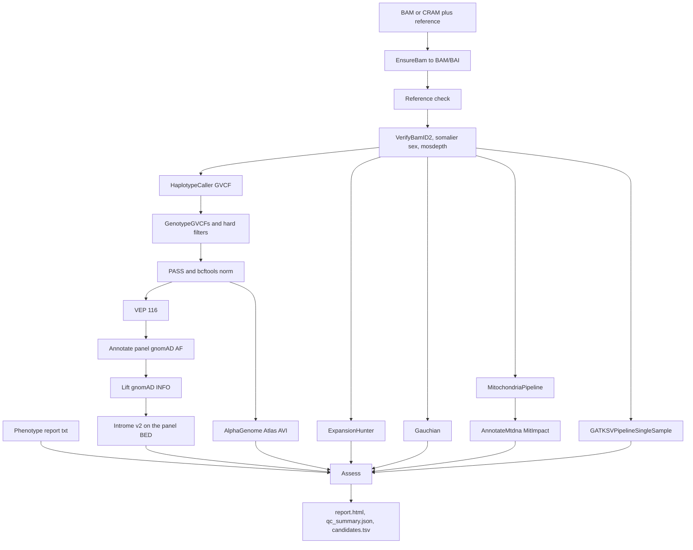
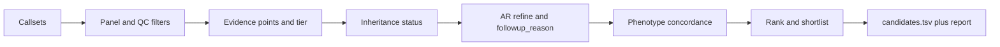

# Per-sample Parkinson's variant assessment

One Terra sample row goes in as a BAM (+ `.bai`) or a CRAM (index optional). `EnsureBam` detects CRAM via magic bytes, converts it to BAM/BAI, then `PdSample` calls every required tool from that BAM, annotates the small-variant VCF, and writes a triage shortlist for that person (`report.html`, `qc_summary.json`, `candidates.tsv`). A cohort is a Terra `sample_set`: Terra launches `PdSample` once per row. There is no cohort workflow.



Assess turns those callsets into a ranked shortlist. How ranking works is in [Variant prioritisation](#variant-prioritisation). Calling and annotation stages are in [What each stage does](#what-each-stage-does) and [`docs/methods.md`](docs/methods.md).

## Dockstore

Register the repository root. `.dockstore.yml` publishes one workflow:

| Name | Descriptor | Example JSON |
| --- | --- | --- |
| `PdSample` | `/workflow/wdl/PdSample.wdl` | `/workflow/terra/PdSample.example.json` |

Import `PdSample` into a Terra workspace. Bind `sample_id`, `bam_or_cram_file`, `bai`, `sex`, and `phenotype_report` to the sample table (WDL inputs are `bam` and optional `bai`; the sample column may still be named `bam_or_cram_file` and may point at a BAM or CRAM). Put reference and resource files on the workspace data table or in the method configuration.

Broad hg38 paths under `gs://gcp-public-data--broad-references` are requester pays. On submit, enable **Use reference disks** and set workflow option `google_project` to your billing GCP project (`workflow/terra/PdSample.workflow_options.example.json`). Set `PdSample.requester_pays_project` to that same project. See [`docs/setup_checklist.md`](docs/setup_checklist.md).

Terra GCP Batch only localizes `gs://` `File` inputs. Relative paths and `https://` URLs fail if they are workflow `File` values, including WDL defaults. `FetchRepoAssets` is volatile and downloads panel, config, scripts, and VerifyBamID SVD files from GitHub at `assets_git_commit` (default `main`), then passes the resulting `gs://` outputs to later tasks. Downstream call cache uses those file content hashes, so a pushed script fix on that ref only reruns consumers of changed files. Stage VEP, somalier, GENCODE GTF, and the alignment into your workspace bucket per [`workflow/terra/STAGING.md`](workflow/terra/STAGING.md). Re-import `PdSample.terra_inputs.json` after upgrades and delete leftover `../` or `https://` method inputs.

## Terra sample table

| Column | Required | Meaning |
| --- | --- | --- |
| `sample_id` | yes | Identifier written into outputs. Use a synthetic id in examples. |
| `bam_or_cram_file` | yes | Aligned GRCh38 BAM or CRAM for this row. |
| `bai` | no | BAM index (`.bai`) or CRAM index (`.crai`). Leave blank for an unindexed CRAM; `EnsureBam` builds a `.bai` after conversion. |
| `sex` | no | Karyotypic sex for QC and X-linked calling: `male` or `female`. Blank, `unspecified`, or anything else is inferred from somalier, then from the X heterozygosity rate. Not used as phenotype concordance input. |
| `phenotype_report` | no | `gs://` text file in the GP2-style sheet layout (`GP2ID`, sex, age at onset, levodopa, exposures and comorbidities). Leave the cell empty when the patient has no report (bound as a String so blank cells do not become an illegal empty File path). |

Add `phenotype_report` to the sample table even when a row leaves it blank. `workflow/terra/PdSample.terra_inputs.json` binds `this.phenotype_report`. The file is parsed into age at onset, levodopa, sampling age, diagnosis, and the comorbidity list for concordance. There are no separate sample-table columns for age at onset, symptoms, or ethnicity.

Assess writes `clinical_match` and `phenotype_score` on each candidate (including risk variants). Concordance is a triage note and a late rank tie-break — it does **not** add evidence points (see [Phenotype and sample classification](#6-phenotype-and-sample-classification)). Levodopa use is a biomarker note on early-onset recessive genes. Comorbidities are printed on the report and are not gene-profile keywords. Genes with no profile stay `no_profile`; a blank phenotype leaves `clinical_match` as `not_assessed`.

A `sample_set` is only a list of those rows. Terra runs `PdSample` per row. Shared reference inputs stay in the method config.

`workflow/terra/PdSample.example.json` uses `SYNTHETIC_SAMPLE`, `gs://YOUR_WORKSPACE_BUCKET/...` placeholders for the example BAM and for the VEP cache and somalier sites (see [`workflow/terra/STAGING.md`](workflow/terra/STAGING.md)), the public VerifyBamID 2.0.3 resource files (via volatile `FetchRepoAssets`), the public GATK hg38 chrM bundle, and the public GATK-SV v1.1.1 hg38 resources plus the 1KG reference panel. `assets_git_commit` defaults to `main` so script/config fetches track the tip; pin it to a SHA to freeze assets. `pdvar_git_commit` is pinned to a commit SHA of https://github.com/gqworks/pdsample-terra for Assess `pip install` (bump when `src/pdvar` changes). `workflow/terra/PdSample.terra_inputs.json` is the Terra form of that config: sample fields are `this.sample_id`, `this.bam_or_cram_file`, `this.bai`, `this.sex`, and `this.phenotype_report`, the mitochondria files are the same public `gs://` paths, `vep_cache` and `somalier_sites` stay `gs://YOUR_WORKSPACE_BUCKET/...`, and each GATK-SV file is a `workspace.<key>` expression. The mapping is `workflow/terra/gatksv_panel_keys.md`.

## What each stage does

1. **Ensure BAM.** `EnsureBam` reads the alignment magic bytes. A CRAM is converted with `samtools view -b` against the workflow reference and indexed to `sample_id.bam` / `sample_id.bam.bai`. A BAM is staged under those names (reusing a usable supplied `.bai`, otherwise indexing). Downstream tasks always see BAM + `.bai`.
2. **Reference check.** The alignment header `@SQ` MD5s are compared with the reference dictionary. A missing `chr` prefix fails the check.
3. **QC.** VerifyBamID2 contamination (`FREEMIX` above 0.02 fails the sample by default), somalier extract plus relate on this sample only (sex; relatedness is not run), and mosdepth on the calling BED. Callers wait on the QC gate.
4. **Small variants.** GATK 4.6.1.0 HaplotypeCaller in GVCF mode, then GenotypeGVCFs, then GATK hard filters, then `bcftools view -f PASS` and `bcftools norm -m -both`. Intervals default to `workflow/assets/monopdaus-genes.grch38.bed`. Set `wgs_small_variants` true to call the whole genome.
5. **Structural variants.** Precedence: (1) sample `sv_prior_vcf` / `sv_prior_vcf_index` (Terra: `this.sv_vcf` / `this.sv_vcf_index`) reuses a previous callset and skips calling (`sv_status` `prior`); (2) else workspace `sv_joint_vcf` / optional `sv_joint_vcf_index` — when `sample_id` is in the header, subset and skip GATK-SV (`sv_status` `joint`); when absent, fall back to calling; (3) else `GATKSVPipelineSingleSample` v1.1.1 (`sv_status` `called`), reusing any non-empty `sv_case_*` evidence and calling the rest. Blank Terra prior/joint/case cells are ignored. Reference-panel inputs stay required for the single-sample path. A missing SV VCF is an error in `pdvar`. `pesr_caller_qc` drops raw Manta DEL/DUP that lack a depth genotype; GATK-SV `FORMAT RD_CN` counts as that genotype when `CN` is absent (joint callsets often omit `CN`). Optional `this.<name>` priors reuse a previous intermediate and skip only that file's producer: `vep_vcf`, `small_vcf`, `sv_vcf`, `expansionhunter_vcf`, `gauchian_json`, `mtdna_vcf`, `introme`, `panel_csv`, `avi_tsv` (each bound in `PdSample.terra_inputs.json`). Empty, missing, placeholder, or zero-byte priors are treated as unset (`ProbePriorFile`; no WDL `size()` on a bad File). Assess still runs.
6. **STRs.** ExpansionHunter 5.0.0 with the vendored 24-locus catalog `workflow/assets/expansionhunter_pd.hg38.json` (includes FGF14, NOTCH2NLC, BEAN1, LRP12, and FXN).
7. **GBA1.** Gauchian 1.0.2.
8. **mtDNA.** GATK `MitochondriaPipeline` 4.7.0.0, then optional MitImpact 4 CSV annotation (`mtdna_mitimpact`) for ClinVar / MITOMAP / gnomAD mtDNA AF / APOGEE2 / MitoTIP / MLC. Ingest keeps alleles with heteroplasmy ≥ 1% and a MITOMAP GenBank frequency entry. High-evidence rows become `mtdna_pathogenic_candidate` in Assess; other carried alleles stay `mtdna_variant` and are not shortlisted.
9. **VEP 116.2.** Offline cache, GRCh38, and `--pick`. Academic **dbNSFP 5.4a** (`dbNSFP5.4a_grch38.gz` + `.tbi`) supplies `CADD_phred`, `REVEL_score`, Eigen, MutationTaster, fathmm-XF, SIFT/PolyPhen2, `clinvar_clnsig`, and missense/splice gnomAD v4.1 joint AF fallback (cache-native VEP SIFT/PolyPhen off by default). Optional panel-sliced **gnomAD v4.1 joint** sites (`gnomad_af_vcf`) annotate complete panel AF including intron/UTR; rebuild with `workflow/scripts/build_panel_gnomad_af.sh` when the panel BED changes. Optional panel-sliced **ClinVar P/LP** sites (`clinvar_plp_vcf`; `workflow/scripts/build_panel_clinvar.sh`) annotate indels and matching SV ids before Assess. Optional genome-wide CADD/REVEL plugins remain as a fallback. `AnnotateGnomadAf` + `LiftGnomadInfo` expose `INFO/gnomAD_AF` / `AF_popmax` for Introme and `pdvar`. `RescueSites` restores non-PASS genotypes at those ClinVar P/LP alleles and at GBA1-PD Browser coordinates so VEP still sees them. A real non-empty `this.vep_vcf` (`vep_prior_vcf`) skips VEP, gnomAD AF, the INFO lift, and panel ClinVar P/LP on the small-variant VCF; Assess still runs. Empty / missing / placeholder / zero-byte `this.vep_vcf` runs that chain. The same probe gates `this.small_vcf` (skips `NormPass` only), `this.expansionhunter_vcf`, `this.gauchian_json`, `this.mtdna_vcf` (skips MitochondriaPipeline + AnnotateMtdna), `this.avi_tsv` (skips AnnotateAvi), `this.panel_csv` (Assess uses the prior; FetchRepoAssets still runs). The GBA1-PD Browser TSV is a shared FetchRepoAssets annotation, not a per-sample prior.
10. **AlphaGenome Atlas AVI.** PASS SNVs are looked up in the precomputed AlphaGenome AVI SNV table (Tabix, GRCh38) when `avi_table` is set. No API key or network call is needed. Phred 30 (top 0.1% of genome-wide SNVs) and Phred 20 (top 1%) add triage points and break rank ties inside Assess. An unset `avi_table` leaves the module `not_assessed`. Indels are not scored. This is a research rank, not a diagnostic call.
11. **Introme v2.** Native WDL port of CCICB/introme `d6da48bc84abda66f588470f79abcf1244acfb21` (`v2@d6da48b`). Restricted to the panel BED. SpliceAI, MMSplice, Pangolin, SPiP, and Spliceogen run in parallel after VariantInfo. Scores are merged onto alleles already in the sample callset. Uncalled Introme alleles are injected only inside genes that already have `followup_reason`: first at ≥ 0.9, and if that gene has none, at ≥ 0.7. The global Introme evidence cutoff stays 0.9. A real non-empty `this.introme` skips the Introme subworkflow (`introme_status` `prior`). Empty / missing / placeholder / zero-byte `this.introme` calls Introme.
12. **Assess.** `pdvar` filters, scores, assigns inheritance, ranks, and writes `report.html`, `qc_summary.json`, and `candidates.tsv`. Full protocol: [Variant prioritisation](#variant-prioritisation).

## Variant prioritisation

`pdvar` (the Assess task) builds one per-sample shortlist. **Point totals are a triage rank, not an ACMG/AMP classification.** Phase is unknown for compound hets. Panel inheritance labels and phenotype profiles are starter literature synthesis pending expert review.



### 1. What enters Assess

| Source | Role in prioritisation |
| --- | --- |
| VEP + dbNSFP / gnomAD | Small variants: consequence, ClinVar, CADD, REVEL, in-silico preds, AF |
| AlphaGenome AVI | Optional SNV Phred bands (points + tie-break) |
| Introme v2 | Splice score on panel alleles already in the callset; uncalled alleles only in `followup_reason` genes (0.9, then 0.7 if that gene has none) |
| GATK-SV | Dosage / LoF SVs on panel gene and exon BEDs. Depth CN is `CN` else `RD_CN`. Depth-only artifacts stay as unscored `sv_artifact`. SNCA copy-gain scores only gene-scale multiplications |
| ExpansionHunter | STR loci; `str_expanded` only with a cited pathogenic floor |
| Gauchian | GBA1 CN / recombinants / catalog SNVs (+ GBA1-PD Browser class bump) |
| MitochondriaPipeline + MitImpact | mtDNA alleles with heteroplasmy and MITOMAP gates |
| Phenotype report | Concordance / tie-break only — no evidence points |

### 2. Keep or drop

Before scoring, `filters.apply_filters` keeps panel alleles (plus always-keep ClinVar P/LP and ExpansionHunter / Gauchian / mtDNA sources). Defaults:

- gnomAD AF / popmax AF ≤ 0.01 (risk-exception genes relax to 0.05)
- depth ≥ 10, GQ ≥ 20, allele balance ≥ 0.2 (with limited depth rescue)
- consequence on the keep list (coding, splice/intron for Introme rescue, SV/STR/mtDNA terms)
- off-panel alleles (including TTN truncations) are dropped

### 3. Evidence points and tiers

Additive points from `config/config.yaml` → `evidence_score` → `tier` (1 best … 4). Main point rules:

| Rule | Default points | Typical trigger |
| --- | --- | --- |
| `clinvar_plp` | +10 | ClinVar pathogenic / likely pathogenic |
| `clinvar_vus` / `clinvar_conflicting` | +3 | ClinVar VUS or conflicting |
| `clinvar_blb` | −10 | ClinVar benign / likely benign |
| `null_variant` | +8 | Stop, frameshift, canonical splice, start lost, transcript ablation |
| `sv_dosage_lof` | +8 | Scored LoF SV (on top of null when applicable) |
| `introme_high` | +4 | Introme class high (≥ 0.9) |
| `cadd_high` / `revel_high` / `avi_high` | +3 each | CADD ≥ 25, REVEL ≥ 0.7, AVI Phred ≥ 30 |
| `cadd_moderate` / `avi_moderate` | +1 each | CADD ≥ 20, AVI Phred ≥ 20 |
| `absent_gnomad` | +2 | Missing / zero AF (mtDNA uses max AF_hom, AF_het) |
| MitImpact / GBA1-PD | +1…8 | MITOMAP / APOGEE2 / MitoTIP / MLC; Gauchian PD class bumps |

Tier cut-offs (first match wins): tier 1 ≥ 10, tier 2 ≥ 6, tier 3 ≥ 3, else tier 4. Extra modules (SV dosage, mtDNA, Introme, GBA1-PD) can add points after the base scorer.

### 4. Inheritance status

Panel MOI (`AD` / `AR` / `XL` / `RISK` / `UNKNOWN`) plus tier gates decide whether a row is a qualifying hit. ClinVar VUS also qualifies below the usual tier floor when `qualify_clinvar_vus` is on.

| Status | Meaning |
| --- | --- |
| `AD_candidate`, `XL_hemi` | Qualifying Mendelian dominant / hemizygous hit |
| `AR_hom`, `AR_comphet_candidate`, `AR_hemizygous`, `AR_second_hit_splice` | Recessive solve (comp-het phase unknown) |
| `AR_single_het` | One AR hit — look for a missed second allele / CNV |
| `risk_carrier`, `risk_biallelic` | Risk gene (e.g. GBA1); biallelic is stronger but still partial |
| `mtdna_pathogenic_candidate` | High-evidence mtDNA; not a nuclear Mendelian solve |
| `str_expanded` | Expansion at or above a cited pathogenic floor |
| `AD_gof_intronic`, `AR_intronic_candidate` | Demoted intron / Introme support |
| `not_qualifying` | Below MOI tier (or off-panel) — dropped from `candidates.tsv` unless `followup_reason` is set |
| `module_not_assessed` | Empty unexplained shortlist stub naming a required module that did not run |

AR refine (`compound.refine`) pairs LoF / exon-disrupting SVs with coding or ClinVar P/LP partners, demotes intron-only false solves, tags incomplete AR genes with `followup_reason`, and notes unphased `AR_comphet_candidate` / `AR_hemizygous` pairs. Assess then searches those follow-up genes for low-depth nulls, ClinVar P/LP, depth-only exon SVs, and gene-scoped Introme hits (0.9 first; 0.7 if that gene has none). SNCA copy-gain is scored only for gene-scale multiplications (`PREDICTED_COPY_GAIN` or exon/TSS overlap and span ≥ 10 kb). `HIGH_SR_BACKGROUND` and in-cohort `FREQ_HET` are annotation; cohort SV AF is not a hard filter.

### 5. Rank and shortlist

`rank_candidates` sorts within each sample by:

1. **Inheritance priority** — Mendelian solves, AD/XL, risk, and high-evidence mtDNA first (`status_priority` 0); STR expansions next; `AR_single_het` / `review_conflict` lower (3); demoted intron statuses lower still
2. **ClinVar preference** — P/LP coding, then VUS coding, then other VUS
3. **Coding over intron noise** — intron-only non-P/LP rows are penalised; intron-only `AD_candidate` is bumped out of the top priority band
4. **Tier**, then **evidence_score**, then **AVI Phred**, then **phenotype_score**

`patient_candidates` keeps the top `max_candidates_per_patient` (default 20) among qualifying rows, then **force-keeps** clinical must-sees that would otherwise fall off: Mendelian / risk / STR / high-evidence mtDNA statuses, ClinVar P/LP, Gauchian rows, scored LoF SVs, early-onset recessive-eopd nulls, empty-shortlist module stubs, and any allele with `followup_reason`. Plain `mtdna_variant` haplogroup rows are never shortlisted.

### 6. Phenotype and sample classification

Phenotype concordance writes `clinical_match` and `phenotype_score` (onset range, feature keywords, enriched ancestry). **It does not add evidence points**; it only breaks ties after tier and AVI. Biomarker multipliers stay 1 until cited.

The report header still classifies the sample from inheritance statuses:

- **solved** — MOI-complete finding outside reduced-penetrance genes (default GBA1, LRRK2), including AD/XL STR expansions and biallelic AR expansions with a confirmed pathogenic motif
- **partially_explained** — risk, reduced-penetrance, single-het AR, high-evidence mtDNA, intron-only AD (including MAPT `splice_gof` without ClinVar P/LP or a canonical splice), or a one-allele / unconfirmed-motif AR expansion
- **unexplained** — none of those

Numeric `explained_liability` stays null until cited penetrances are set in config. Incomplete AR genes are tagged with `followup_reason` on the shortlist rows.

### 7. How to read `candidates.tsv`

Work top-down by `rank`. Same-gene partners for AR review share `gene` and often a non-empty `followup_reason`. Use `inheritance_status`, `evidence_reasons`, `tier`, ClinVar / AF / Introme / SV fields, then `clinical_match` as a triage note. Full column meanings: [`docs/data_dictionary.md`](docs/data_dictionary.md).

## Hard filters

These are **GATK callset** filters on the small-variant VCF (before VEP / Assess). Single-sample hard filters are used because VQSR fits tranches on a cohort and this repository does not ship a CNN scoring model. SNP sites fail when `QD < 2.0`, `QUAL < 30.0`, `SOR > 3.0`, `FS > 60.0`, `MQ < 40.0`, `MQRankSum < -12.5`, or `ReadPosRankSum < -8.0`. INDEL sites fail when `QD < 2.0`, `QUAL < 30.0`, `FS > 200.0`, or `ReadPosRankSum < -20.0`. `NormPass` keeps `PASS` records. `RescueSites` can restore a non-PASS carrier at a panel ClinVar P/LP site or a GBA1-PD Browser coordinate (`INFO/PDVAR_RESCUE`) before that step. Separate panel / AF / depth rules inside Assess are listed under [Keep or drop](#2-keep-or-drop).

## Outputs written back to the row

| Output | File |
| --- | --- |
| `candidates` | Assess array, in order: `report.html` (triage narrative + classification), `qc_summary.json` (module / callset status), `candidates.tsv` (ranked shortlist, including `followup_reason` alleles). Column dictionary: [`docs/data_dictionary.md`](docs/data_dictionary.md) |
| `vep_vcf` / `vep_vcf_index` | `{sample_id}.vep.vcf.gz` — VEP VCF after the gnomAD INFO lift and optional ClinVar P/LP annotation, written back as `this.vep_vcf` / `this.vep_vcf_index` for reuse |
| `small_vcf` / `small_vcf_index` | Normalized PASS small-variant VCF (`NormPass`), written back as `this.small_vcf` / `this.small_vcf_index` |
| `sv_vcf` / `sv_vcf_index` | `{sample_id}.sv.vcf.gz` — GATK-SV call, joint subset, or reused `sv_prior_vcf` (written back for the next run) |
| `expansionhunter_vcf` | ExpansionHunter VCF, written back as `this.expansionhunter_vcf` |
| `gauchian_json` | Gauchian JSON, written back as `this.gauchian_json` |
| `mtdna_vcf` | Annotated mtDNA VCF, written back as `this.mtdna_vcf` |
| `introme` | `{sample_id}.introme.predictions.tsv` — Introme scores, written back as `this.introme` for reuse |
| `panel_csv` | Panel inheritance CSV used by Assess, written back as `this.panel_csv` |
| `avi_tsv` | AlphaGenome AVI lookup table for this sample (`File?`), written back as `this.avi_tsv` |
| `coverage_counts`, `manta_vcf`, `manta_index`, `pesr_disc`, `pesr_disc_index`, `pesr_sd`, `pesr_sd_index`, `pesr_split`, `pesr_split_index`, `scramble_vcf`, `scramble_index`, `scramble_clusters`, `scramble_table`, `wham_vcf`, `wham_index` | GatherSampleEvidence intermediates (`File?`). Set when `GatkSvSingle` runs; unset on the joint-SV path. Reuse as `sv_case_*` inputs on later runs. |
| `sample_metrics_files` | `Array[File]` of GatherSampleEvidence metrics (manta/wham/SR/PE/counts) when `sv_run_sampleevidence_metrics` is true (default); empty on the joint-SV path |

## Assess container

Build from the repository root and push:

```bash
docker build -f workflow/containers/pdvar/Dockerfile -t REGISTRY/pdvar:COMMIT .
docker push REGISTRY/pdvar:COMMIT
```

Set `pdvar_docker` to that image. The image copies this package, `config/`, and `resources/panel/`.

To run without a custom image, leave `pdvar_docker` at `python:3.11.11-slim-bookworm` and pin `pdvar_git_commit` to a commit SHA of `gqworks/pdsample-terra`; Assess installs `git+https://github.com/gqworks/pdsample-terra.git@SHA`. An empty commit with no installed `pdvar` stops the task. Script/config assets use `assets_git_commit` separately (default `main`, volatile fetch).

## Two panel BEDs

`workflow/assets/monopdaus-genes.grch38.bed` is the calling and Introme interval list (gene spans). `resources/panel/monopdaus-genes.grch38.bed` and `monopdaus-exons.grch38.bed` are the overlap BEDs the SV scorer uses. Spans are the union of GENCODE-primary / MANE exons per panel ENSG (±5 kb flank; exons ±100 bp), rebuilt with `workflow/scripts/build_panel_beds.py` from GENCODE v44 — not every exon that merely overlaps an Ensembl gene interval (that mislabelled GPR4 exons as OPA3). Inheritance labels in `resources/panel/monopdaus-gene-inheritance.csv` drive Assess MOI status and are placeholders pending expert review. `GBA` is aliased to `GBA1`.

## Cost

The default interval list keeps HaplotypeCaller, VEP, and Introme on the panel gene spans. Whole-genome small-variant calling (`wgs_small_variants`) and a full GATK-SV reference-panel run dominate cost. Introme's SpliceAI, MMSplice, and Pangolin tasks are the next largest CPU (or GPU) block. ExpansionHunter, Gauchian, VerifyBamID2, somalier, and mosdepth are small beside those. The mitochondria workflow realigns chrM. Assess (`pdvar`) is cheap beside callers. There is no joint genotyping and no VQSR.

`ReleaseAfterQc` hardlinks the BAM and `.bai` after the QC gate (as `sample_id.bam` / `sample_id.bam.bai`) so the imported mitochondria and GATK-SV workflows do not start early. The task disk is twice the BAM size so a cross-filesystem copy can finish when a hardlink is unavailable.

## Local assessment

```bash
pip install -e ".[dev]"
pdvar sample.json --panel resources/panel/monopdaus-gene-inheritance.csv --outdir out
pytest
bash workflow/scripts/validate_wdl.sh
```

`outdir` receives the same Assess trio Terra writes: `report.html`, `qc_summary.json`, `candidates.tsv` (plus `report.md` for the narrative source).

## Limits and staging

Prioritisation is triage only (see [Variant prioritisation](#variant-prioritisation)). Penetrance and PRS stay null until cited in `config/config.yaml`. STR floors live under `str_loci` (STRchive-cited; `workflow/assets/expansionhunter_catalog_sources.tsv`). Panel inheritance labels (`resources/panel/monopdaus-gene-inheritance.csv`) and phenotype profiles (`config/gene_phenotypes.yaml`) are starter literature synthesis and need expert review before use beyond triage.

Resources to stage: [`workflow/terra/STAGING.md`](workflow/terra/STAGING.md), [`docs/setup_checklist.md`](docs/setup_checklist.md). Tool versions: [`workflow/README.md`](workflow/README.md). Annotation methods: [`docs/methods.md`](docs/methods.md).
