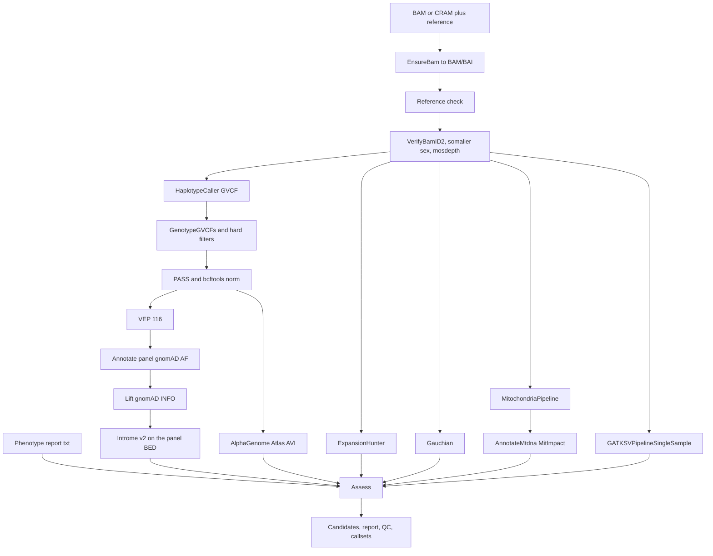

# Per-sample Parkinson's variant assessment

One Terra sample row goes in as a BAM (+ `.bai`) or a CRAM (index optional). `EnsureBam` detects CRAM via magic bytes, converts it to BAM/BAI, then `PdSample` calls every required tool from that BAM, annotates the small-variant VCF, and writes a ranked candidate list for that person. A cohort is a Terra `sample_set`: Terra launches `PdSample` once per row. There is no cohort workflow.



## Dockstore

Register the repository root. `.dockstore.yml` publishes one workflow:

| Name | Descriptor | Example JSON |
| --- | --- | --- |
| `PdSample` | `/workflow/wdl/PdSample.wdl` | `/workflow/terra/PdSample.example.json` |

Import `PdSample` into a Terra workspace. Bind `sample_id`, `bam_or_cram_file`, `bai`, `sex`, and `phenotype_report` to the sample table (WDL inputs are `bam` and optional `bai`; the sample column may still be named `bam_or_cram_file` and may point at a BAM or CRAM). Put reference and resource files on the workspace data table or in the method configuration.

Broad hg38 paths under `gs://gcp-public-data--broad-references` are requester pays. On submit, enable **Use reference disks** and set workflow option `google_project` to your billing GCP project (`workflow/terra/PdSample.workflow_options.example.json`). Set `PdSample.requester_pays_project` to that same project. See [`docs/setup_checklist.md`](docs/setup_checklist.md).

Terra GCP Batch only localizes `gs://` `File` inputs. Relative paths and `https://` URLs fail if they are workflow `File` values, including WDL defaults. `FetchRepoAssets` is volatile and downloads panel, config, scripts, and VerifyBamID SVD files from GitHub at `assets_git_commit` (default `main`), then passes the resulting `gs://` outputs to later tasks. Downstream call cache uses those file content hashes, so a pushed script fix on that ref only reruns consumers of changed files. Stage VEP, somalier, GENCODE GTF, and the alignment into your workspace bucket per [`workflow/terra/STAGING.md`](workflow/terra/STAGING.md). Re-import `PdSample.terra_inputs.json` after upgrades and delete leftover `../` or `https://` method inputs.

## Terra sample table

| Column | Required | Meaning |
| --- | --- | --- |
| `sample_id` | yes | Identifier written into outputs. Use a synthetic id in examples. |
| `bam_or_cram_file` | yes | Aligned GRCh38 BAM or CRAM for this row. |
| `bai` | no | BAM index (`.bai`) or CRAM index (`.crai`). Leave blank for an unindexed CRAM; `EnsureBam` builds a `.bai` after conversion. |
| `sex` | no | Karyotypic sex for QC and X-linked calling: `male` or `female`. Blank, `unspecified`, or anything else is inferred from somalier, then from the X heterozygosity rate. Not used as phenotype concordance input. |
| `phenotype_report` | no | `gs://` text file in the GP2-style sheet layout (`GP2ID`, sex, age at onset, levodopa, exposures and comorbidities). Leave the cell empty when the patient has no report (bound as a String so blank cells do not become an illegal empty File path). |

Add `phenotype_report` to the sample table even when a row leaves it blank. `workflow/terra/PdSample.terra_inputs.json` binds `this.phenotype_report`. The file is parsed into age at onset, levodopa, sampling age, diagnosis, and the comorbidity list for concordance. There are no separate sample-table columns for age at onset, symptoms, or ethnicity.

Assess writes `clinical_match` on each candidate, including risk variants (`risk_carrier`, `risk_biallelic`, and genes flagged `risk_allele_exception`). Fields parsed from the phenotype file drive that match. Levodopa use is stored as a biomarker note on early-onset recessive genes. Comorbidities are printed on the report. They are not gene-profile keywords, so hypertension, constipation, hearing loss, and the other lines on the example sheet do not by themselves mark a risk variant as clinically matched. Genes with no profile stay `no_profile`. A blank phenotype leaves `clinical_match` as `not_assessed`.

A `sample_set` is only a list of those rows. Terra runs `PdSample` per row. Shared reference inputs stay in the method config.

`workflow/terra/PdSample.example.json` uses `SYNTHETIC_SAMPLE`, `gs://YOUR_WORKSPACE_BUCKET/...` placeholders for the example BAM and for the VEP cache and somalier sites (see [`workflow/terra/STAGING.md`](workflow/terra/STAGING.md)), the public VerifyBamID 2.0.3 resource files (via volatile `FetchRepoAssets`), the public GATK hg38 chrM bundle, and the public GATK-SV v1.1.1 hg38 resources plus the 1KG reference panel. `assets_git_commit` defaults to `main` so script/config fetches track the tip; pin it to a SHA to freeze assets. `pdvar_git_commit` is pinned to a commit SHA of https://github.com/gqworks/pdsample-terra for Assess `pip install` (bump when `src/pdvar` changes). `workflow/terra/PdSample.terra_inputs.json` is the Terra form of that config: sample fields are `this.sample_id`, `this.bam_or_cram_file`, `this.bai`, `this.sex`, and `this.phenotype_report`, the mitochondria files are the same public `gs://` paths, `vep_cache` and `somalier_sites` stay `gs://YOUR_WORKSPACE_BUCKET/...`, and each GATK-SV file is a `workspace.<key>` expression. The mapping is `workflow/terra/gatksv_panel_keys.md`.

## What each stage does

1. **Ensure BAM.** `EnsureBam` reads the alignment magic bytes. A CRAM is converted with `samtools view -b` against the workflow reference and indexed to `sample_id.bam` / `sample_id.bam.bai`. A BAM is staged under those names (reusing a usable supplied `.bai`, otherwise indexing). Downstream tasks always see BAM + `.bai`.
2. **Reference check.** The alignment header `@SQ` MD5s are compared with the reference dictionary. A missing `chr` prefix fails the check.
3. **QC.** VerifyBamID2 contamination (`FREEMIX` above 0.02 fails the sample by default), somalier extract plus relate on this sample only (sex; relatedness is not run), and mosdepth on the calling BED. Callers wait on the QC gate.
4. **Small variants.** GATK 4.6.1.0 HaplotypeCaller in GVCF mode, then GenotypeGVCFs, then GATK hard filters, then `bcftools view -f PASS` and `bcftools norm -m -both`. Intervals default to `workflow/assets/monopdaus-genes.grch38.bed`. Set `wgs_small_variants` true to call the whole genome.
5. **Structural variants.** Precedence: (1) sample `sv_prior_vcf` / `sv_prior_vcf_index` (Terra: `this.sv_vcf` / `this.sv_vcf_index`) reuses a previous callset and skips calling (`sv_status` `prior`); (2) else workspace `sv_joint_vcf` / optional `sv_joint_vcf_index` — when `sample_id` is in the header, subset and skip GATK-SV (`sv_status` `joint`); when absent, fall back to calling; (3) else `GATKSVPipelineSingleSample` v1.1.1 (`sv_status` `called`). Reference-panel inputs stay required for the single-sample path. A missing SV VCF is an error in `pdvar`.
6. **STRs.** ExpansionHunter 5.0.0 with the vendored 19-locus catalog `workflow/assets/expansionhunter_pd.hg38.json`.
7. **GBA1.** Gauchian 1.0.2.
8. **mtDNA.** GATK `MitochondriaPipeline` 4.7.0.0, then optional MitImpact 4 CSV annotation (`mtdna_mitimpact`) for ClinVar / MITOMAP / gnomAD mtDNA AF / APOGEE2 / MitoTIP.
9. **VEP 116.2.** Offline cache, GRCh38, and `--pick`. Academic **dbNSFP 5.4a** (`dbNSFP5.4a_grch38.gz` + `.tbi`) supplies `CADD_phred`, `REVEL_score`, Eigen, MutationTaster, fathmm-XF, SIFT/PolyPhen2, `clinvar_clnsig`, and missense/splice gnomAD v4.1 joint AF fallback (cache-native VEP SIFT/PolyPhen off by default). Optional panel-sliced **gnomAD v4.1 joint** sites (`gnomad_af_vcf`) annotate complete panel AF including intron/UTR; rebuild with `workflow/scripts/build_panel_gnomad_af.sh` when the panel BED changes. Optional genome-wide CADD/REVEL plugins remain as a fallback. `AnnotateGnomadAf` + `LiftGnomadInfo` expose `INFO/gnomAD_AF` / `AF_popmax` for Introme and `pdvar`.
10. **AlphaGenome Atlas AVI.** PASS SNVs are looked up in the precomputed AlphaGenome AVI SNV table (Tabix, GRCh38) when `avi_table` is set. No API key or network call is needed. Phred 30 (top 0.1% of genome-wide SNVs) and Phred 20 (top 1%) add triage points and break rank ties. An unset `avi_table` leaves the module `not_assessed`. Indels are not scored. This is a research rank, not a diagnostic call.
11. **Introme v2.** Native WDL port of CCICB/introme `d6da48bc84abda66f588470f79abcf1244acfb21` (`v2@d6da48b`). Restricted to the panel BED. SpliceAI, MMSplice, Pangolin, SPiP, and Spliceogen run in parallel after VariantInfo.
12. **Assess.** `pdvar` ranks candidates and writes the Terra outputs. When `phenotype_report` is set, the GP2-style report is compared with `config/gene_phenotypes.yaml`. `clinical_match` on a risk variant records whether that gene's onset range, key clinical features, or enriched ancestry fit the patient. The match is a triage note. It does not add evidence points. A higher `phenotype_score` breaks ties after tier and AlphaGenome Phred. Profiles cover every gene in `resources/panel/monopdaus-gene-inheritance.csv` (sources and confidence in `config/gene_phenotypes.SOURCES.md`). They are a starter literature synthesis and need expert clinical review. Low-evidence candidates and the risk genes PSAP and TMEM175 have minimal profiles with no onset range, so they are usually `uninformative`. A gene outside the panel is `no_profile`.

## Hard filters

Single-sample hard filters are used because VQSR fits tranches on a cohort and this repository does not ship a CNN scoring model. SNP sites fail when `QD < 2.0`, `QUAL < 30.0`, `SOR > 3.0`, `FS > 60.0`, `MQ < 40.0`, `MQRankSum < -12.5`, or `ReadPosRankSum < -8.0`. INDEL sites fail when `QD < 2.0`, `QUAL < 30.0`, `FS > 200.0`, or `ReadPosRankSum < -20.0`. Only `PASS` records continue.

## Outputs written back to the row

| Output | File |
| --- | --- |
| `candidates` | Array of Assess files: `report.html`, `qc_summary.json`, `liability.tsv`, `followup.tsv`, `candidates.tsv` |
| `vep_vcf` | `{sample_id}.vep.vcf.gz` — VEP VCF after the gnomAD INFO lift |
| `sv_vcf` / `sv_vcf_index` | `{sample_id}.sv.vcf.gz` — GATK-SV call, joint subset, or reused `sv_prior_vcf` (written back for the next run) |
| `coverage_counts`, `manta_vcf`, `manta_index`, `pesr_disc`, `pesr_disc_index`, `pesr_sd`, `pesr_sd_index`, `pesr_split`, `pesr_split_index`, `scramble_vcf`, `scramble_index`, `scramble_clusters`, `scramble_table`, `wham_vcf`, `wham_index` | GatherSampleEvidence intermediates (`File?`). Set when `GatkSvSingle` runs; unset on the joint-SV path. Reuse as `sv_case_*` inputs on later runs. |
| `sample_metrics_files` | `Array[File]` of GatherSampleEvidence metrics (manta/wham/SR/PE/counts) when `sv_run_sampleevidence_metrics` is true (default); empty on the joint-SV path |

## Assess container

Build from the repository root and push:

```bash
docker build -f workflow/containers/pdvar/Dockerfile -t REGISTRY/pdvar:COMMIT .
docker push REGISTRY/pdvar:COMMIT
```

Set `pdvar_docker` to that image. The image copies this package, `config/`, and `resources/panel/`.

To run without a custom image, leave `pdvar_docker` at `python:3.11.11-slim-bookworm` and pin `pdvar_git_commit` to a commit SHA of `gqworks/pdsample-terra`; Assess installs `git+https://github.com/gqworks/pdsample-terra.git@SHA`. An empty commit with no installed `pdvar` stops the task. Script/config assets use `assets_git_commit` separately (default `main`, volatile fetch).

## Two panel BEDs

`workflow/assets/monopdaus-genes.grch38.bed` is the calling and Introme interval list (gene spans). `resources/panel/monopdaus-genes.grch38.bed` and `monopdaus-exons.grch38.bed` are the overlap BEDs the SV scorer uses. Inheritance labels live in `resources/panel/monopdaus-gene-inheritance.csv` and are placeholders pending expert review. `GBA` is aliased to `GBA1`.

## Cost

The default interval list keeps HaplotypeCaller, VEP, and Introme on the panel gene spans. Whole-genome small-variant calling (`wgs_small_variants`) and a full GATK-SV reference-panel run dominate cost. Introme's SpliceAI, MMSplice, and Pangolin tasks are the next largest CPU (or GPU) block. ExpansionHunter, Gauchian, VerifyBamID2, somalier, and mosdepth are small beside those. The mitochondria workflow realigns chrM. There is no joint genotyping and no VQSR.

`ReleaseAfterQc` hardlinks the BAM and `.bai` after the QC gate (as `sample_id.bam` / `sample_id.bam.bai`) so the imported mitochondria and GATK-SV workflows do not start early. The task disk is twice the BAM size so a cross-filesystem copy can finish when a hardlink is unavailable.

## Local assessment

```bash
pip install -e ".[dev]"
pdvar sample.json --panel resources/panel/monopdaus-gene-inheritance.csv --outdir out
pytest
bash workflow/scripts/validate_wdl.sh
```

## Scientific scope

The scorer keeps panel genes, ACMG-style point evidence (ClinVar P/LP, ClinVar VUS, predicted null alleles, CADD, REVEL, absent gnomAD, Introme splice), a second allele inside the same sample, SV/STR/GBA1/mtDNA rows (MitImpact MITOMAP/APOGEE2/MitoTIP points; high-evidence mtDNA is `mtdna_pathogenic_candidate` and partial liability only), phenotype concordance, and penetrance scaffolding. ClinVar VUS alleles also qualify for inheritance hits below the usual tier floor; ranking prefers P/LP, then coding VUS, then non-coding VUS. Point totals are a triage rank. They are not an ACMG/AMP classification. Phenotype concordance asks whether a candidate gene, including a risk variant, fits the patient's age at onset, symptoms, and ancestry. Penetrance and PRS coefficients stay null until a citation is set in `config/config.yaml`. STR pathogenic floors live under `str_loci` (STRchive-cited; see `workflow/assets/expansionhunter_catalog_sources.tsv`). Off-panel alleles, including TTN truncations, are dropped by the panel filter. Compound hets stay `AR_comphet_candidate`.

Resources you still have to stage are listed in [`workflow/terra/STAGING.md`](workflow/terra/STAGING.md) and [`docs/setup_checklist.md`](docs/setup_checklist.md). Tool versions and images are in [`workflow/README.md`](workflow/README.md).
